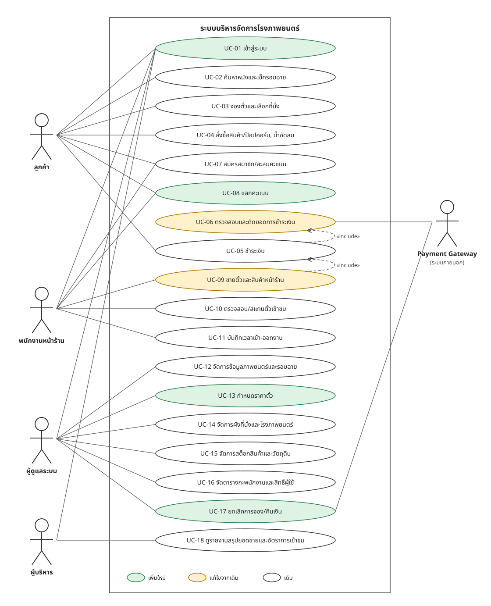

# ระบบบริหารจัดการโรงภาพยนตร์

เว็บแอปสำหรับจัดการโรงภาพยนตร์ ครอบคลุมการจองตั๋วออนไลน์ การขายหน้าร้าน สต็อกสินค้า พนักงาน และรายงานสำหรับผู้บริหาร

> สถานะ: เฟส 0-2 เสร็จแล้ว และเฟส 3 กำลังทดสอบ (จองตั๋ว, ผังที่นั่งเรียลไทม์, ชำระเงิน, ตั๋ว QR)

## เริ่มต้นใช้งาน

ต้องมี Node.js 22.12 ขึ้นไป

```bash
npm install
```

คัดลอก `.env.example` เป็น `.env.local` แล้วใส่ค่าที่ได้จากเจ้าของโปรเจกต์ ส่วนการจ่ายเงินทดสอบต้องมีคีย์ลับของ Supabase และ Omise test mode

```bash
npm run dev
```

เปิด http://localhost:3000

| คำสั่ง | หน้าที่ |
|---|---|
| `npm run dev` | รันเว็บสำหรับพัฒนา |
| `npm test` | รัน unit test |
| `npm run lint` | ตรวจรูปแบบโค้ด |
| `npm run build` | build สำหรับใช้งานจริง |

### ตั้งบทบาทผู้ใช้

ผู้ใช้ใหม่เป็น `customer` เสมอ ส่วนการเปลี่ยนบทบาทยังไม่มีหน้าจอจนถึงเฟส 5 ให้รันใน Supabase SQL Editor แล้วเปลี่ยนอีเมลและบทบาทตามต้องการ

```sql
update public.profiles
set role = 'admin' -- staff, admin หรือ executive
where id = (select id from auth.users where email = 'you@example.com');
```

### ฐานข้อมูล

- Migration อยู่ใน `supabase/migrations`
- ข้อมูลตัวอย่างอยู่ใน `supabase/seed.sql` ซึ่งใช้กับฐานข้อมูลใหม่ครั้งเดียว
- ถ้าแก้โครงสร้างฐานข้อมูล ให้สร้าง `lib/supabase/database.types.ts` ใหม่
- ทดสอบสิทธิ์ด้วยไฟล์ใน `supabase/tests` ซึ่งทำงานใน transaction ที่ rollback
- หน้าที่จำกัดบทบาทต้องครอบด้วย `RoleSection` และทุกตารางต้องเปิด RLS

## Use Case Diagram



ดู [diagram เวอร์ชันแรก](docs/use-case-diagram.png) ได้ที่นี่

## เอกสารออกแบบ

- [ขอบเขตและกติการะบบ](docs/requirements.md)
- [โครงสร้างฐานข้อมูล](docs/database.md)
- [Flow การจองและชำระเงิน](docs/booking-flow.md)
- [Wireframe หน้าจอหลัก](docs/wireframes.png)

## ส่วนของระบบ

| ส่วน | ผู้ใช้ | งานหลัก |
|---|---|---|
| เว็บลูกค้า | ลูกค้า | ค้นหาหนัง/รอบฉาย, จองตั๋ว/เลือกที่นั่ง, สั่งสินค้า, ชำระเงิน, สมาชิก/คะแนน |
| POS หน้าร้าน | พนักงาน | ขายตั๋ว/สินค้า, สแกนตั๋ว, สมัครสมาชิก, บันทึกเวลาเข้า-ออกงาน |
| หลังบ้าน | ผู้ดูแลระบบ | จัดการหนัง/รอบฉาย, ผังที่นั่ง/โรง, สต็อก, ตารางกะ/สิทธิ์ผู้ใช้ |
| Dashboard | ผู้บริหาร | รายงานยอดขายและอัตราการเข้าชม |

## Tech Stack ที่วางแผนไว้

- Next.js + TypeScript
- Tailwind CSS + shadcn/ui
- Supabase (PostgreSQL, Auth, Realtime, Storage)
- Omise หรือ Stripe (test mode)
- Vitest + Playwright
- Vercel

## แผนการทำ

| เฟส | งาน |
|---|---|
| 0 | แก้ diagram, ออกแบบ ER และ flow การจอง |
| 1 | ตั้งโปรเจกต์, ฐานข้อมูล, login, 4 บทบาท |
| 2 | หลังบ้าน: หนัง, โรง, ผังที่นั่ง, รอบฉาย |
| 3 | จองตั๋ว, ล็อกที่นั่ง, ชำระเงิน, ออกตั๋ว QR |
| 4 | POS, สแกนตั๋ว, สินค้า, ตัดสต็อก |
| 5 | สมาชิก/คะแนน, กะงาน, เวลาเข้า-ออกงาน |
| 6 | รายงาน, ทดสอบ, deploy |

## การทำงานร่วมกัน

- แตก branch จาก `main` ทุกครั้งก่อนเริ่มงาน เช่น `feature/seat-booking`
- ส่งงานผ่าน Pull Request และให้เพื่อนรีวิวก่อน merge
- ห้าม commit ไฟล์ `.env` หรือรหัสลับ ให้ใส่ตัวอย่างไว้ใน `.env.example`
