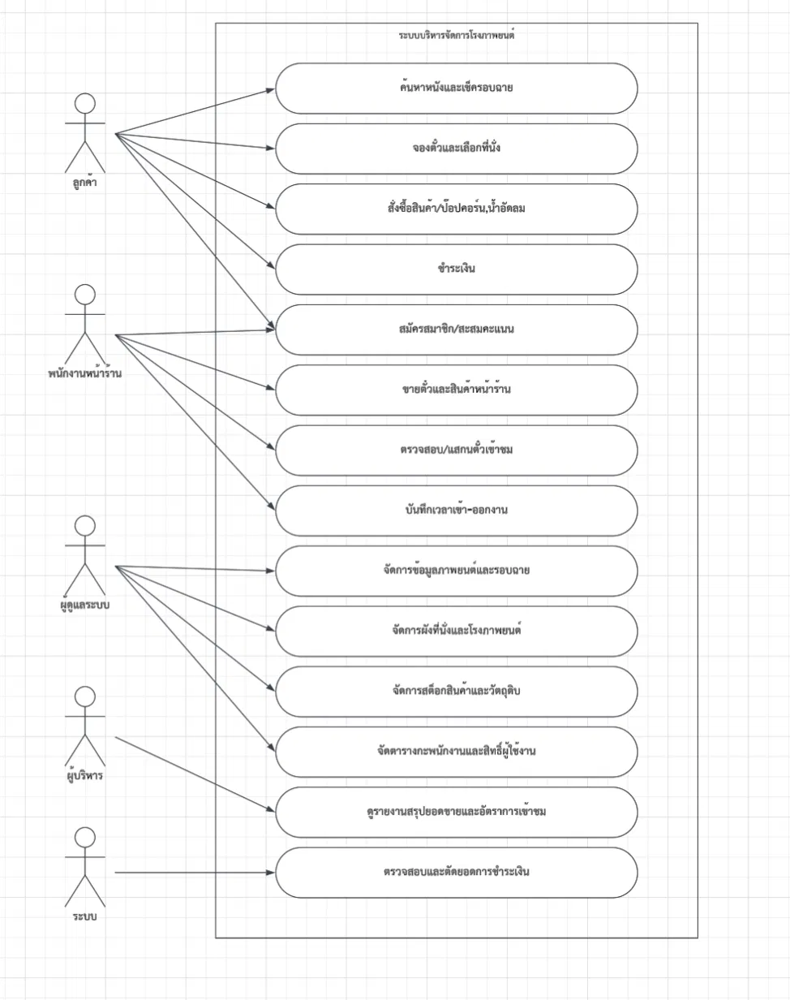

# ระบบบริหารจัดการโรงภาพยนตร์

เว็บแอปสำหรับจัดการโรงภาพยนตร์ ครอบคลุมการจองตั๋วออนไลน์ การขายหน้าร้าน สต็อกสินค้า พนักงาน และรายงานสำหรับผู้บริหาร

> สถานะ: ยังไม่เริ่มเขียนโค้ด อยู่ระหว่างวางแผน

## Use Case Diagram

## ส่วนของระบบ

| ส่วน | ผู้ใช้ | งานหลัก |
|---|---|---|
| เว็บลูกค้า | ลูกค้า | ค้นหาหนัง/รอบฉาย, จองตั๋ว/เลือกที่นั่ง, สั่งสินค้า, ชำระเงิน, สมาชิก/คะแนน |
| POS หน้าร้าน | พนักงาน | ขายตั๋ว/สินค้า, สแกนตั๋ว, สมัครสมาชิก, บันทึกเวลาเข้า-ออกงาน |
| หลังบ้าน | ผู้ดูแลระบบ | จัดการหนัง/รอบฉาย, ผังที่นั่ง/โรง, สต็อก, ตารางกะ/สิทธิ์ผู้ใช้ |
| Dashboard | ผู้บริหาร | รายงานยอดขายและอัตราการเข้าชม |

## Tech Stack ที่วางแผนไว้

- Next.js + TypeScript
- Tailwind CSS + shadcn/ui
- Supabase (PostgreSQL, Auth, Realtime, Storage)
- Omise หรือ Stripe (test mode)
- Vitest + Playwright
- Vercel

## แผนการทำ

| เฟส | งาน |
|---|---|
| 0 | แก้ diagram, ออกแบบ ER และ flow การจอง |
| 1 | ตั้งโปรเจกต์, ฐานข้อมูล, login, 4 บทบาท |
| 2 | หลังบ้าน: หนัง, โรง, ผังที่นั่ง, รอบฉาย |
| 3 | จองตั๋ว, ล็อกที่นั่ง, ชำระเงิน, ออกตั๋ว QR |
| 4 | POS, สแกนตั๋ว, สินค้า, ตัดสต็อก |
| 5 | สมาชิก/คะแนน, กะงาน, เวลาเข้า-ออกงาน |
| 6 | รายงาน, ทดสอบ, deploy |

## การทำงานร่วมกัน

- แตก branch จาก `main` ทุกครั้งก่อนเริ่มงาน เช่น `feature/seat-booking`
- ส่งงานผ่าน Pull Request และให้เพื่อนรีวิวก่อน merge
- ห้าม commit ไฟล์ `.env` หรือรหัสลับ ให้ใส่ตัวอย่างไว้ใน `.env.example`
