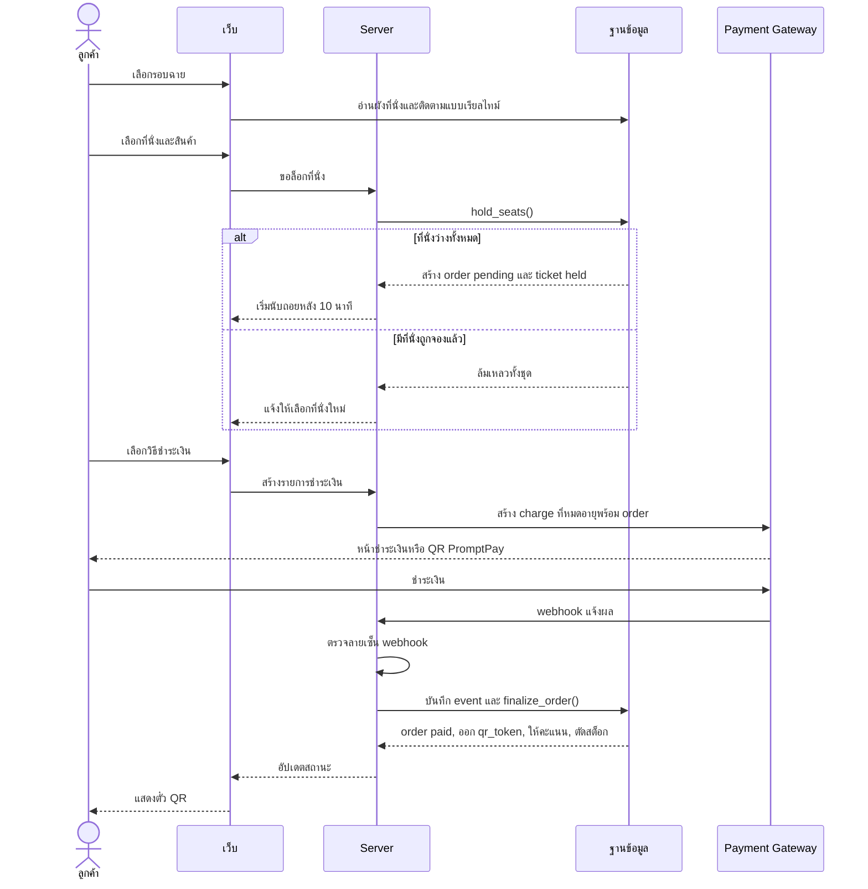
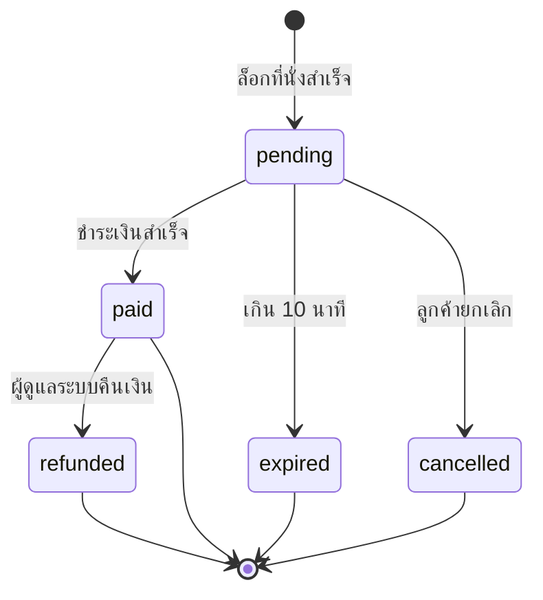
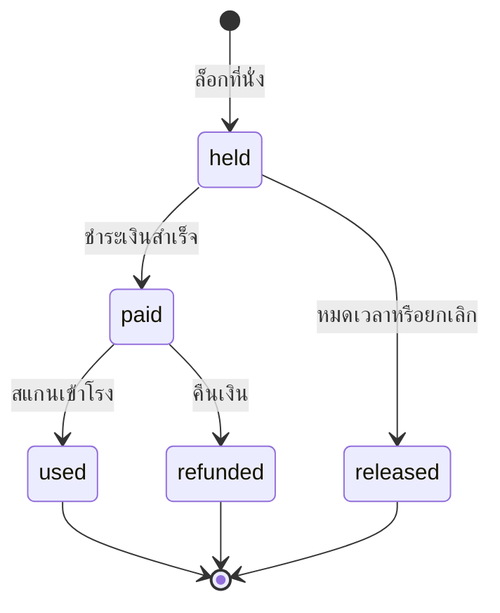

# Flow การจองและชำระเงิน

## จองตั๋วออนไลน์

## ขายหน้าร้าน

ใช้ `hold_seats()` และ `finalize_order()` ชุดเดียวกับออนไลน์ ต่างกันที่ `channel = 'pos'` และไม่บังคับให้มีลูกค้า

1. พนักงานเลือกรอบฉาย ที่นั่ง และสินค้า
2. ระบบล็อกที่นั่งเหมือนการจองออนไลน์
3. **เงินสด:** พนักงานกดยืนยันรับเงิน ระบบบันทึกชื่อผู้รับเงินและเรียก `finalize_order()`
4. **PromptPay:** ระบบแสดง QR และรอ webhook เหมือนการจองออนไลน์
5. ระบบแสดงตั๋ว QR ให้ลูกค้า

## สถานะคำสั่งซื้อ

## สถานะตั๋ว

ตั๋วที่เป็น `released` หรือ `refunded` จะคืนที่นั่งให้ขายต่อได้ทันที

## ฟังก์ชันหลัก

ทุกฟังก์ชันทำงานใน transaction เดียว ถ้าขั้นตอนใดล้มเหลวจะไม่มีการเปลี่ยนแปลงใด ๆ

| ฟังก์ชัน | หน้าที่ |
|---|---|
| `hold_seats` | ปล่อยที่นั่งที่หมดเวลาของชุดนั้น ตรวจรอบฉาย คำนวณราคาจากฐานข้อมูล สร้าง order และ tickets |
| `apply_points` | ตรวจและหักคะแนนตั้งแต่ก่อนจ่ายเงิน เพื่อกันการใช้คะแนนซ้ำ |
| `finalize_order` | ล็อกแถว order, ทำงานต่อเมื่อเป็น `pending`, ออก `qr_token`, ให้คะแนน และตัดสต็อก |
| `expire_orders` | งานตั้งเวลาทุก 1 นาที เปลี่ยน order ที่หมดเวลาเป็น `expired`, ปล่อยที่นั่ง และคืนคะแนน |
| `check_in_ticket` | เปลี่ยนตั๋ว `paid` เป็น `used` แบบอะตอมมิก และตรวจช่วงเวลาที่สแกนได้ |
| `refund_order` | ตรวจเงื่อนไข สั่งคืนเงิน เปลี่ยนสถานะ และปรับคะแนน |

## กรณีผิดปกติ

| กรณี | การจัดการ |
|---|---|
| สองคนกดที่นั่งเดียวกันพร้อมกัน | unique index รับคนแรก อีกคนได้รับแจ้งให้เลือกใหม่ |
| จองหลายที่นั่งแล้วชนหนึ่งที่นั่ง | ยกเลิกทั้งชุด ไม่ล็อกบางที่นั่ง |
| ปิดหน้าเว็บระหว่างรอจ่าย | `expire_orders` ปล่อยที่นั่งเมื่อหมดเวลา |
| ชำระเงินไม่สำเร็จ | order ยังเป็น `pending` ลองใหม่ได้จนกว่าจะหมดเวลา |
| webhook ส่งซ้ำ | `webhook_events` กันซ้ำ และ `finalize_order` ทำงานเฉพาะ `pending` |
| เงินเข้าหลัง order หมดอายุ | ไม่ออกตั๋ว คืนเงินอัตโนมัติ และบันทึกให้ผู้ดูแลระบบตรวจ |
| หน้าเว็บส่งราคาหรือยอดเงินปลอม | Server คำนวณราคาจากฐานข้อมูลเสมอ |
| webhook ปลอม | ตรวจลายเซ็นก่อนประมวลผล |
| สแกนตั๋วซ้ำ | แจ้งว่าใช้แล้ว พร้อมเวลาที่สแกนครั้งแรก |
| สแกนผิดรอบหรือนอกเวลา | ไม่ให้เข้า และแจ้งรอบฉายที่ถูกต้อง |
| ยกเลิกรอบฉายที่ขายแล้ว | คืนเงินทุก order ของรอบนั้น และแจ้งผู้ดูแลระบบถ้ารายการใดไม่สำเร็จ |
