# โครงสร้างฐานข้อมูล

ใช้ PostgreSQL บน Supabase รหัสหลักเป็น `uuid` และทุกตารางมี `created_at` ซึ่งละไว้ในแผนภาพ

ที่นั่งใช้ตาราง `tickets` ตารางเดียวทั้งตอนล็อกและหลังขาย แทน `bookings` กับ `seat_holds` ในแผนแรก สถานะที่นั่งจึงอยู่ที่เดียวและไม่ต้องคอยซิงก์สองตาราง

## ER Diagram

```mermaid
erDiagram
    profiles ||--o{ orders : "ซื้อ"
    profiles ||--o{ point_transactions : "มีรายการคะแนน"
    profiles ||--o{ shifts : "มีกะงาน"
    profiles ||--o{ attendance : "ลงเวลา"
    movies ||--o{ showtimes : "ฉายใน"
    theaters ||--o{ showtimes : "จัดใน"
    theaters ||--o{ seats : "มี"
    seat_types ||--o{ seats : "กำหนดประเภท"
    showtimes ||--o{ tickets : "ออกตั๋ว"
    seats ||--o{ tickets : "ถูกจอง"
    orders ||--o{ tickets : "มี"
    orders ||--o{ order_items : "มี"
    orders ||--o{ payments : "ชำระด้วย"
    orders ||--o{ point_transactions : "เกิดคะแนน"
    products ||--o{ order_items : "ถูกขาย"
    products ||--o{ product_recipes : "ใช้สูตร"
    ingredients ||--o{ product_recipes : "เป็นส่วนผสม"
    ingredients ||--o{ stock_movements : "เคลื่อนไหว"
    orders ||--o{ stock_movements : "ตัดสต็อก"
    shifts ||--o{ attendance : "อ้างอิง"

    profiles {
        uuid id PK "อ้างอิง auth.users"
        text full_name
        text phone
        text role "customer staff admin executive"
        int points_balance
    }
    movies {
        uuid id PK
        text title
        text synopsis
        int duration_min
        text rating
        text poster_url
        date release_date
        text status "coming_soon now_showing ended"
    }
    theaters {
        uuid id PK
        text name
        boolean is_active
    }
    seat_types {
        uuid id PK
        text name
        numeric surcharge
    }
    seats {
        uuid id PK
        uuid theater_id FK
        uuid seat_type_id FK
        text row_label
        int seat_number
        boolean is_active
    }
    showtimes {
        uuid id PK
        uuid movie_id FK
        uuid theater_id FK
        timestamptz starts_at
        timestamptz ends_at
        numeric base_price
        text status "scheduled cancelled"
    }
    orders {
        uuid id PK
        text order_no UK
        uuid customer_id FK "ว่างได้เมื่อขายหน้าร้าน"
        uuid sold_by FK "พนักงานผู้ขาย"
        text channel "online pos"
        text status "pending paid expired cancelled refunded"
        numeric subtotal
        numeric discount
        numeric total
        timestamptz expires_at
        timestamptz items_picked_up_at
    }
    tickets {
        uuid id PK
        uuid order_id FK
        uuid showtime_id FK
        uuid seat_id FK
        numeric price
        text status "held paid used released refunded"
        text qr_token UK
        timestamptz checked_in_at
        uuid checked_in_by FK
    }
    products {
        uuid id PK
        text name
        numeric price
        text image_url
        boolean is_active
    }
    order_items {
        uuid id PK
        uuid order_id FK
        uuid product_id FK
        int quantity
        numeric unit_price
    }
    ingredients {
        uuid id PK
        text name
        text unit
        numeric quantity_on_hand
        numeric reorder_level
    }
    product_recipes {
        uuid product_id PK, FK
        uuid ingredient_id PK, FK
        numeric quantity
    }
    stock_movements {
        uuid id PK
        uuid ingredient_id FK
        uuid order_id FK "ว่างได้"
        numeric change_qty
        text reason "purchase sale adjustment"
        uuid created_by FK
    }
    payments {
        uuid id PK
        uuid order_id FK
        text method "card promptpay cash"
        text provider
        text provider_charge_id UK
        numeric amount
        text status "pending succeeded failed refunded"
        timestamptz paid_at
        uuid received_by FK "พนักงานผู้รับเงินสด"
        timestamptz refunded_at
        uuid refunded_by FK
        text refund_reason
    }
    webhook_events {
        text provider_event_id PK
        jsonb payload
        timestamptz processed_at
    }
    point_transactions {
        uuid id PK
        uuid profile_id FK
        uuid order_id FK
        int points "บวกหรือลบ"
        text type "earn redeem reverse"
    }
    shifts {
        uuid id PK
        uuid staff_id FK
        timestamptz starts_at
        timestamptz ends_at
        uuid created_by FK
    }
    attendance {
        uuid id PK
        uuid staff_id FK
        uuid shift_id FK "ว่างได้"
        timestamptz clock_in
        timestamptz clock_out
    }
```



## กลุ่มตาราง

| กลุ่ม | ตาราง |
|---|---|
| ผู้ใช้ | `profiles` |
| หนังและโรง | `movies`, `theaters`, `seat_types`, `seats`, `showtimes` |
| การขาย | `orders`, `tickets`, `order_items`, `payments`, `webhook_events` |
| คะแนน | `point_transactions` |
| สินค้าและสต็อก | `products`, `ingredients`, `product_recipes`, `stock_movements` |
| พนักงาน | `shifts`, `attendance` |

## กฎที่บังคับในฐานข้อมูล

**หนึ่งที่นั่งมีตั๋วที่ใช้งานได้ใบเดียวต่อรอบ** ถ้ามีคนจองชนกัน คำสั่งที่มาทีหลังจะล้มเหลวทันที

```sql
create unique index tickets_one_active_seat
  on tickets (showtime_id, seat_id)
  where status in ('held', 'paid', 'used');
```

**รอบฉายในโรงเดียวกันเวลาต้องไม่ทับกัน**

```sql
create extension if not exists btree_gist;

alter table showtimes add constraint showtimes_no_overlap
  exclude using gist (
    theater_id with =,
    tstzrange(starts_at, ends_at) with &&
  ) where (status <> 'cancelled');
```

**ที่นั่งไม่ซ้ำในโรงเดียวกัน**

```sql
alter table seats add constraint seats_unique_position
  unique (theater_id, row_label, seat_number);
```

**webhook เดียวประมวลผลครั้งเดียว:** `webhook_events.provider_event_id` เป็น primary key

## หลักการของข้อมูล

- `tickets.price` และ `order_items.unit_price` เก็บราคา ณ เวลาขาย
- `point_transactions` คือประวัติคะแนนทั้งหมด ส่วน `profiles.points_balance` คือยอดรวมที่เก็บไว้เพื่ออ่านเร็ว และต้องแก้ใน transaction เดียวกัน
- `stock_movements` คือประวัติสต็อก ส่วน `ingredients.quantity_on_hand` คือยอดคงเหลือ
- ไม่ลบข้อมูลหนังหรือสินค้าที่เคยขายแล้ว ให้เปลี่ยนสถานะแทน
- ทุกตารางเปิด Row Level Security และกำหนดสิทธิ์ตาม [ตารางสิทธิ์](requirements.md#สิทธิ์ตามบทบาท)
